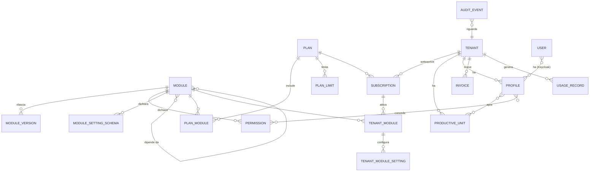

# PSAAS Admin Portal – Funzionalità, verifica E2E e proposta di espansione

*Documento del 22/10/2026 · base: branch `develop`, commit `dd0b7aa`*

## Indice

1. [Cos'è l'Admin Portal](#1-cosè-ladmin-portal)
2. [Architettura in breve](#2-architettura-in-breve)
3. [Funzionalità attuali rispetto ai requisiti](#3-funzionalità-attuali-rispetto-ai-requisiti)
4. [Verifica end-to-end con screenshot](#4-verifica-end-to-end-con-screenshot)
5. [Lacune e rischi rilevati](#5-lacune-e-rischi-rilevati)
6. [Proposta di espansione (analisi di business)](#6-proposta-di-espansione-analisi-di-business)
7. [Roadmap proposta](#7-roadmap-proposta)
8. [Come estendere questa proposta](#8-come-estendere-questa-proposta)

---

## 1. Cos'è l'Admin Portal

PSAAS è un gestionale B2B multi-tenant: una **base comune** estendibile con **moduli** (plugin). Ogni azienda cliente è un **tenant**.

L'**Admin Portal** è il pannello di controllo del gestore della piattaforma. Oggi serve a:

- **gestire i clienti**: cercarli, consultarli, attivarli e (a breve) modificarne anagrafica e organizzazione;
- **modellare l'organizzazione di ogni cliente**: unità produttive (reparti, filiali) e profili, cioè regole che aprono l'accesso a una o più unità;
- **gestire gli utenti dei clienti**: crearli in Keycloak con i loro profili, anche di clienti diversi, e cercarli su tutta la piattaforma;
- **avere una visione d'insieme** dei profili di tutti i clienti.

Ha un solo attore, l'**Amministratore** (ruolo Keycloak `Administrator`), e due sistemi esterni: **Keycloak** (identità dell'amministratore e archivio degli utenti dei clienti) e la **lista dei comuni italiani** (validazione di città e CAP).

Fuori ambito oggi, come dichiarato in [`docs/use-cases/README.md`](../use-cases/README.md): disattivazione o cancellazione dei clienti, comunicazioni, licenze, abbonamenti, fatturazione, report, storico delle modifiche, ruoli con permessi ridotti, modifica e cancellazione degli utenti. La [sezione 6](#6-proposta-di-espansione-analisi-di-business) parte proprio da qui.

## 2. Architettura in breve

| Parte | Tecnologia | Responsabilità |
|---|---|---|
| Frontend | React 19, Vite, TypeScript, Tailwind + daisyUI, TanStack Query, react-hook-form + zod, i18next (it/en) | UI dell'amministratore; login Keycloak con PKCE; validazione lato client con gli stessi codici d'errore del backend |
| Backend | ASP.NET Core (.NET 10), clean architecture: Domain, Application, Infrastructure, AdminPortal.Backend | API REST `/api/*`, tutte protette dal ruolo `Administrator` |
| Dati | PostgreSQL (EF Core) | Clienti, profili, unità produttive e loro collegamenti |
| Identità | Keycloak (realm `PSAAS`) | Login dell'amministratore; utenti dei clienti con attributi `birthDate`, `profileIds`, `mfaRequired`, `createdBy`, `invitesSent`, `lastInviteAt`; eventi di login per l'ultimo accesso |
| Orchestrazione locale | .NET Aspire (AppHost) | Avvia Postgres, backend e frontend |
| Qualità | xUnit con Testcontainers (accettazione), test unitari per strato, Vitest | Uno o più test per ogni scenario Gherkin |

Contratto HTTP: [`docs/use-cases/API.md`](../use-cases/API.md). Collection Postman: [`docs/postman`](../postman/PSAAS.AdminPortal.postman_collection.json).

### Design system "Admin console"

Dai mock del designer ([`mockups/`](mockups/), schermata 1a), realizzato con i temi daisyUI 5 in `src/app/styles/index.css`:

- **Temi** `psaas` (chiaro, predefinito) e `psaas-dark` (segue la preferenza del sistema), colori in oklch: superfici neutre fredde, un solo accento indaco per l'azione principale, verde/ambra/rosso/grigio riservati agli **stati** (`StatusBadge`). La sidebar usa il colore `neutral` (ink) e resta scura in entrambi i temi.
- **Densità**: testo a 13 px, campi e pulsanti da 32 px (`--size-field`), tabelle da 36 px per riga (`.table-dense`), dati (P.IVA, id, date, conteggi) in **IBM Plex Mono**, testo in **IBM Plex Sans** (self-hosted con `@fontsource`).
- **Struttura**: sidebar a gruppi (Operatività, Catalogo, Amministrazione) con versione e realm; topbar con percorso (dichiarato dalle pagine tramite `PageHeader`), ricerca globale, badge d'ambiente (`VITE_ENVIRONMENT_LABEL`), lingua, tema (ricordato nel browser), avatar con identità e ruoli (UC8).

## 3. Funzionalità attuali rispetto ai requisiti

Stato rilevato dal codice e dalla suite di test di accettazione (aggiornato a ogni fase del lavoro sui mock: vedi [PROGRESS.md](PROGRESS.md)).

| UC | Funzionalità | Requisiti principali | Backend | Frontend | Stato |
|---|---|---|---|---|---|
| [UC1](../use-cases/UC1-cercare-clienti.md) | Cercare i clienti | Ricerca su ragione sociale (ignorando maiuscole, spazi e punteggiatura), P.IVA e PEC; paginazione 1–100 | `GET /api/tenants` | Elenco del mock 1c (vedi UC21) | ✅ |
| [UC2](../use-cases/UC2-consultare-cliente.md) | Consultare la scheda di un cliente | Anagrafica, sede, profili con numero di utenti, unità produttive, matrice profilo × unità | `GET /api/tenants/{id}` | Scheda a schede (mock 1d): Panoramica, Anagrafica, Organizzazione, card laterali | ✅ |
| [UC3](../use-cases/UC3-attivare-cliente.md) | Attivare un nuovo cliente | Dati obbligatori; ragione sociale ≤ 20 caratteri e unica; P.IVA `IT` + 11 cifre unica; PEC unica; comune e CAP validi; organizzazione facoltativa nella stessa richiesta | `POST /api/tenants` | Form unico con anagrafica e organizzazione | ✅ |
| [UC4](../use-cases/UC4-modificare-anagrafica.md) | Modificare l'anagrafica | Stesse regole di UC3; l'unicità esclude il cliente stesso | `PUT /api/tenants/{id}` | Scheda Anagrafica con controllo dei campi univoci all'uscita e barra delle modifiche | ✅ |
| [UC5](../use-cases/UC5-modificare-organizzazione.md) | Modificare l'organizzazione | Aggiungere, rinominare, togliere profili e unità; togliere un profilo lo toglie agli utenti | `PUT /api/tenants/{id}/organization` | Matrice cliccabile (mock 1d) con rimozioni barrate, celle cambiate evidenziate e avviso sugli utenti coinvolti | ✅ |
| [UC6](../use-cases/UC6-creare-utente.md) | Creare un utente | Email = username unica; profili di clienti diversi; Keycloak invia l'email per la password; la password non passa dal portale | `POST /api/users` | Form con scelta dei profili raggruppati per cliente | ✅ Implementato (richiede la configurazione Keycloak, vedi §5) |
| [UC7](../use-cases/UC7-cercare-utenti.md) | Cercare gli utenti | Ricerca globale su nome, cognome ed email; filtri per cliente, profilo e stato; pagine; stato e ultimo accesso | `GET /api/users` | Vista Utenti del mock 1f con filtri, contatore e paginazione; scheda Utenti del cliente | ✅ Implementato (richiede la configurazione Keycloak) |
| [UC8](../use-cases/UC8-chi-sono.md) | Sapere chi sono | Identità e ruoli solo dal token | `GET /api/me` | Home e menu profilo | ✅ |
| [UC9](../use-cases/UC9-panoramica-profili.md) | Panoramica dei profili | Tutti i profili, ordinati per nome, con il loro cliente | `GET /api/profiles` | Pagina Profili | ✅ |
| [UC10](../use-cases/UC10-cercare-comune.md) | Cercare un comune | Almeno 2 caratteri, massimo 20 risultati, ordinati per pertinenza | `GET /api/geography/cities` | Suggerimenti nel campo Città e CAP | ✅ |
| [UC11](../use-cases/UC11-verificare-campo-cliente.md) | Verificare un campo univoco | Stesse regole e codici del salvataggio, campo per campo; indica il cliente che usa già il valore | `GET /api/tenants/field-validation` | Controllo all'uscita dal campo con "Disponibile" o link al cliente in conflitto | ✅ |
| [UC12](../use-cases/UC12-audit-log.md) | Audit log e storico (EXP-10) | Chi, cosa, quando, su quale cliente; prima/dopo per l'anagrafica; aggiunte e rimozioni per l'organizzazione; filtri e pagine | `GET /api/audit` | Pagina Audit log con filtri nell'URL; scheda Storico e card Storico nella scheda cliente | ✅ |
| [UC13](../use-cases/UC13-stato-cliente.md) | Stato del cliente (EXP-04) | Onboarding, Trial, Attivo, Sospeso, In disdetta, Cessato; transizioni consentite; motivo per sospensione, disdetta, cessazione | `POST /api/tenants/{id}/status` | Badge di stato, codice `tn_…`, "Cliente dal" e menu "…" con dialog del motivo nella scheda | ✅ |
| [UC14](../use-cases/UC14-onboarding-cliente.md) | Onboarding guidato (EXP-04, mock 1e) | Bozza salvata al primo passo, ripresa e annullamento; codice SDI e referente | `POST /api/tenants` (`draft`), `DELETE /api/tenants/{id}` | Wizard a 5 passi con pannello Controlli, combobox comuni con CAP dal comune, "Bozza salvata alle…"; passo 2 con scelta di piano, prova e add-on | ✅ |
| [UC21](../use-cases/UC21-elenco-clienti.md) | Filtrare, ordinare ed esportare i clienti (mock 1c) | Schede con conteggi (Tutti, Attivi, Trial, Onboarding, Sospesi, Rinnovo < 30 gg); filtri per stato, piano, modulo, provincia, rinnovo; ordinamento; utenti rispetto al limite; export CSV | `GET /api/tenants`, `/counts`, `/export` | Schede, chip dei filtri, scelta colonne, selezione multipla con Cambia piano ed Esporta, "Esc per deselezionare" | ✅ |
| [UC22](../use-cases/UC22-viste-salvate.md) | Viste salvate (mock 1c) | Viste personali per amministratore, nome unico, max 20 | `GET/POST/DELETE /api/saved-views` | "+ Salva vista" accanto alle schede | ✅ |
| [UC23](../use-cases/UC23-fatturazione.md) | Fatturare i periodi (EXP-08) | Prima fattura alla sottoscrizione, rinnovi, fine prova, pro-rata sul cambio piano, numerazione annuale, IVA 22%, scadenza 30 gg; trasmissione dietro porta (oggi interna, senza SDI) | `POST /api/billing/run`, job `BillingJob` | Pulsante "Esegui fatturazione" | ✅ |
| [UC24](../use-cases/UC24-incassi-solleciti.md) | Incassi, solleciti e morosità (EXP-08) | Pagamenti con data e riferimento, scadute e solleciti ogni 7 gg, sospensione dopo 30 gg, annullamento con nota di credito | `GET /api/invoices`, `/summary`, `/{id}`, `POST …/payments`, `POST …/cancel` | Pagina Fatturazione con indicatori, filtri e pannello fattura; scheda Fatture del cliente | ✅ |
| [UC25](../use-cases/UC25-uso-cliente.md) | Uso del cliente (EXP-09) | Metriche inviate dai moduli (contatori e misure per giorno) con ruolo dedicato; utenti, utenti attivi e unità rispetto al piano | `POST /api/usage`, `GET /api/tenants/{id}/usage` | Scheda "Uso" con indicatori e andamento giornaliero a 7/30/90 giorni | ✅ |
| [UC26](../use-cases/UC26-stato-servizi.md) | Stato dei servizi collegati (EXP-09) | Database, Keycloak, API utenti, elenco comuni, hook dei moduli, trasmissione fatture; timeout 5 s per servizio | `GET /api/system/services` | Riquadro "Servizi collegati" in Impostazioni (e in Panoramica con la fase 11) | ✅ |
| [UC19](../use-cases/UC19-gestire-utente.md) | Gestire un utente (EXP-06, mock 1f) | Stati Invito inviato / Attivo / Sospeso / Disattivato; modifica di dati, profili ed MFA; reinvio invito, reset password, disattiva/riattiva; tutto nello storico | `GET/PUT /api/users/{id}`, `POST /api/users/{id}/invite\|reset-password\|disable\|enable` | Pannello laterale con azioni, profili raggruppati per cliente cliccabili e dettagli | ✅ (richiede la configurazione Keycloak) |
| [UC20](../use-cases/UC20-importare-utenti.md) | Importare utenti da CSV (EXP-06) | Anteprima con errori per riga (codici di UC6), poi creazione delle righe valide; max 500 righe | `POST /api/users/import` | Dialog "Importa CSV" con modello scaricabile | ✅ |
| [UC15](../use-cases/UC15-catalogo-moduli.md) | Catalogo dei moduli (EXP-01) | Core sempre presente; registrazione da manifest JSON con versione semantica, dipendenze e permessi; nuova versione = stesso id; deprecazione | `GET/POST /api/modules`, `PUT /api/modules/{id}/status` | Pagina Moduli con manifest da incollare, stati e numero di clienti | ✅ |
| [UC16](../use-cases/UC16-piani.md) | Piani commerciali (EXP-02) | Codice unico, prezzo e periodicità, prova 0–90 giorni, limiti di utenti e unità, moduli inclusi | `GET/POST/PUT /api/plans` | Pagina Piani con form di creazione e modifica | ✅ |
| [UC17](../use-cases/UC17-sottoscrizione.md) | Sottoscrizione del cliente (EXP-03) | Piano con prova e add-on; moduli con dipendenze; limiti del piano anche per i nuovi utenti (UC6); prezzo bloccato | `GET/PUT /api/tenants/{id}/subscription`, `GET /api/subscriptions` | Scheda "Abbonamento e moduli", badge del piano nell'intestazione, pagina Sottoscrizioni, passo 2 del wizard | ✅ |
| [UC18](../use-cases/UC18-provisioning.md) | Provisioning dei moduli (EXP-03) | Hook del manifest; stato per modulo con errore e tentativi; riprova manuale e automatica (3 tentativi) | `POST /api/tenants/{id}/modules/{moduleId}/retry`, job `ProvisioningRetryJob` | Card "Moduli attivi" (mock 1d), pulsante Riprova, conteggio dei falliti in Sottoscrizioni | ✅ |
| GEN | Sicurezza | Ogni operazione richiede autenticazione e ruolo `Administrator`; `/health` anonimo | Policy globale sui controller | Login obbligatorio, logout | ✅ |

Funzionalità trasversali già presenti:

- **Lingue** italiano e inglese, con scelta salvata nel browser.
- **Tema** chiaro e scuro.
- **Layout responsive**, con menu laterale richiudibile.
- **Errori di validazione per campo**: gli stessi codici (`Required`, `InvalidFormat`, `MaxLengthExceeded`, `NotUnique`, `InvalidValue`) arrivano dal backend e vengono tradotti dal frontend.
- **Log strutturati** NLog in JSON, con traceId e utente.
- **Health check** su `/health`.

## 4. Verifica end-to-end con screenshot

**Come è stata fatta.** Il 22/10/2026 l'ambiente locale è stato avviato con Aspire (Postgres in container, backend, frontend su `localhost:5173`) e collegato al Keycloak reale (`auth.fin-horizon.com`, realm `PSAAS`). Lo script Playwright (Microsoft Edge, 1440×900) ha usato l'applicazione come un amministratore: login manuale, poi navigazione dai link interni. Per ogni passo ha salvato uno screenshot, l'esito, gli avvisi mostrati e le chiamate `/api` con il loro stato HTTP. Gli esiti sono stati poi ricontrollati sugli screenshot.

**Dati di prova creati:** cliente `E2E Test 969436 Srl` (P.IVA `IT92663969436`, PEC `e2e969436@pec.example.com`, profilo "Operatore" che apre l'unità "Stabilimento"). L'utente `giulia.ferri.969436@example.com` **non** è stato creato (vedi passo 19).

**Riepilogo:** 25 passi · ✅ 16 OK · ⚠️ 1 da completare · ❌ 8 KO. Dei KO, 3 dipendono da funzionalità ancora da implementare (UC1-S4, UC4, UC5), 4 dalla configurazione locale di Keycloak per gli utenti (UC6/UC7) e 1 da un difetto di configurazione del client Keycloak (deep link).

| # | Passo | UC | Atteso | Esito | Osservato | Screenshot |
|---|---|---|---|---|---|---|
| 01 | Home e utente corrente | UC8 | Dati dell'amministratore autenticato | ✅ | ID Keycloak, nome, email e ruoli (`Administrator` compreso) letti dal token; `GET /api/me` 200 | [01](screenshots/01-home-e-utente-corrente.png) |
| 02 | Menu profilo | UC8 | Menu con identità e logout | ✅ | Nome, email, "Impostazioni" ed "Esci" | [02](screenshots/02-menu-profilo.png) |
| 03 | Elenco clienti | UC1 | Elenco paginato | ✅ | 3 clienti ordinati per ragione sociale, con P.IVA, P.IVA completa, PEC e città; paginazione. Al primo caricamento dopo l'avvio la risposta arriva dopo qualche secondo (avvio a freddo) | [03](screenshots/03-elenco-clienti.png) |
| 04 | Ricerca senza risultati | UC1 | Stato vuoto | ✅ | "Nessun cliente corrisponde a "zzzz-nessuno"", non un errore | [04](screenshots/04-ricerca-clienti-senza-risultati.png) |
| 05 | Nuovo cliente vuoto | UC3 | Errori per campo | ✅ | "Campo obbligatorio" su tutti i dati anagrafici, nessuna chiamata al server | [05](screenshots/05-nuovo-cliente-vuoto.png) |
| 06 | P.IVA non valida | UC3, UC11 | Errore di formato all'uscita dal campo | ✅ | "Formato non valido" su "IT123" | [06](screenshots/06-nuovo-cliente-p-iva-non-valida.png) |
| 07 | Ricerca comune | UC10 | Suggerimenti di comuni | ✅ | `GET /api/geography/cities` 200 per "Rom"; i suggerimenti sono un elenco nativo del browser, quindi non compaiono nello screenshot | [07](screenshots/07-ricerca-comune.png) |
| 08 | Nuovo cliente compilato | UC3 | Anagrafica e organizzazione | ✅ | Profilo "Operatore" collegato all'unità "Stabilimento" | [08](screenshots/08-nuovo-cliente-compilato.png) |
| 09 | Scheda del cliente creato | UC3, UC2 | Scheda con anagrafica e matrice | ✅ | `POST /api/tenants` 201; P.IVA nazionale ricavata; matrice profilo × unità corretta | [09](screenshots/09-scheda-del-cliente-creato.png) |
| 10 | Ricerca per ragione sociale | UC1 | Il cliente compare | ✅ | Trovato | [10](screenshots/10-ricerca-del-cliente-creato.png) |
| 11 | Ricerca per PEC | UC1-S4 | Il cliente compare | ❌ | Nessun risultato: la ricerca per PEC non è implementata (test UC1-S4 già rosso) | [11](screenshots/11-ricerca-per-pec.png) |
| 12 | Duplicato prima del salvataggio | UC11 | Ragione sociale segnalata come già usata | ✅ | "Valore già in uso" all'uscita dal campo | [12](screenshots/12-duplicato-rilevato-prima-del-salvataggio.png) |
| 13 | Modifica anagrafica | UC4 | Salvataggio | ❌ | `PUT /api/tenants/{id}` → **405**; avviso generico "Si è verificato un errore imprevisto" | [13](screenshots/13-modifica-anagrafica.png) |
| 14 | Modifica organizzazione | UC5 | Salvataggio | ❌ | `PUT /api/tenants/{id}/organization` → **404**; avviso "Elemento non trovato", fuorviante perché il cliente esiste | [14](screenshots/14-modifica-organizzazione.png) |
| 15 | Panoramica profili | UC9 | Profili di tutti i clienti | ✅ | 4 profili con descrizione e cliente; filtro locale per profilo, descrizione o cliente | [15](screenshots/15-panoramica-profili.png) |
| 16 | Elenco utenti | UC7 | Elenco o stato vuoto | ❌ | `GET /api/users` → **500**: dopo i tentativi automatici compare l'errore generico | [16](screenshots/16-elenco-utenti.png) |
| 17 | Nuovo utente vuoto | UC6 | Errori per campo | ✅ | "Campo obbligatorio" su nome, cognome, email e data; profili raggruppati per cliente | [17](screenshots/17-nuovo-utente-vuoto.png) |
| 18 | Email non valida | UC6 | Errore di formato | ✅ | Errore sull'email, nessuna chiamata al server | [18](screenshots/18-nuovo-utente-email-non-valida.png) |
| 19 | Creazione utente | UC6 | Utente creato e confermato | ❌ | `POST /api/users` → **500** "Si è verificato un errore imprevisto" | [19](screenshots/19-creazione-utente-con-profilo.png) |
| 20 | Ricerca utenti | UC7 | Utenti corrispondenti | ❌ | `GET /api/users?search=giulia` → **500** | [20](screenshots/20-ricerca-utenti.png) |
| 21 | Impostazioni | – | Lingua e tema | ⚠️ | Pagina vuota (solo il titolo): lingua e tema si cambiano dall'intestazione | [21](screenshots/21-impostazioni.png) |
| 22 | Pagina inesistente | – | 404 | ✅ | Pagina "non trovata" con ritorno alla home | [22](screenshots/22-pagina-inesistente.png) |
| 23 | Tema scuro e inglese | – | UI tradotta e scura | ✅ | Etichette in inglese, tema scuro | [23](screenshots/23-tema-scuro-e-lingua-inglese.png) |
| 24 | Vista mobile (390 px) | – | Layout utilizzabile | ✅ | Menu richiuso; la tabella scorre in orizzontale (si vedono solo ragione sociale e P.IVA senza scorrere) | [24](screenshots/24-vista-mobile.png) |
| 25 | Apertura diretta di un URL | GEN | Ricaricare `/tenants` riporta su `/tenants` | ❌ | Keycloak risponde **"Invalid parameter: redirect_uri"** | [25](screenshots/25-apertura-diretta-di-un-indirizzo-deep-link-o-refresh.png) |

Note sul metodo:
- I passi 12 e 17 risultavano KO nello script perché il selettore non riconosceva il messaggio d'errore. Gli screenshot mostrano che l'applicazione si comporta correttamente, quindi sono riportati come OK.
- Al contrario, i passi 16 e 20 risultavano OK nello script perché la pagina si apriva, ma la chiamata API restituiva 500. Sono riportati come KO.
- Lo screenshot del passo 01 contiene l'email e l'ID Keycloak dell'amministratore che ha fatto il login.

## 5. Lacune e rischi rilevati

In ordine di impatto. La colonna **Stato** riporta le correzioni fatte dopo la verifica E2E del 22/10/2026.

| # | Problema | Effetto | Origine | Rimedio proposto | Stato |
|---|---|---|---|---|---|
| G1 | **Deep link e refresh rifiutati da Keycloak** (passo 25) | Ricaricare qualunque pagina diversa dalla home, o aprire un link condiviso, porta a "Invalid parameter: redirect_uri". L'utente deve tornare a mano alla home. | Il client Keycloak del frontend accetta come *Valid redirect URI* solo la home; `keycloak.init` usa l'URL corrente come indirizzo di ritorno | In Keycloak, client `adminportal-frontend`: *Valid redirect URIs* = `http://localhost:5173/*` (e l'equivalente in produzione). Nessuna modifica al codice. | Aperto: configurazione Keycloak |
| G2 | **Utenti non utilizzabili in locale** (passi 16, 19, 20) | Elenco, ricerca e creazione utenti rispondono 500 | Il backend locale non ha `Keycloak:ClientSecret`: il service account non ottiene il token per l'API di amministrazione | Configurare il client `adminportal-api` come descritto in [API.md](../use-cases/API.md#keycloak-come-archivio-utenti-uc6-uc7): segreto negli user secrets, ruoli `view-users` e `manage-users`, attributi `birthDate` e `profileIds` nel *User profile*, SMTP del realm | Parziale: ora 503 con causa nel log e avviso all'avvio; la configurazione Keycloak resta da fare |
| G3 | **UC4 e UC5 senza backend** (passi 13, 14) | Le pagine di modifica esistono ma il salvataggio fallisce | Mancano `PUT /api/tenants/{id}` e `PUT /api/tenants/{id}/organization` (10 test di accettazione rossi) | Implementare i due casi d'uso. UC5 deve anche togliere agli utenti in Keycloak i profili rimossi (UC5-R4), quindi serve un'operazione in più su `IUserDirectory`. | ✅ Risolto: UC4 e UC5 implementati, profili tolti rimossi anche in Keycloak |
| G4 | **Ricerca per PEC assente** (passo 11) | Non si trova un cliente per PEC | UC1-S4 non implementato nel repository | Aggiungere la PEC normalizzata ai campi di ricerca di `TenantReadRepository` | ✅ Risolto: ricerca per PEC |
| G5 | Messaggi d'errore poco chiari | Un 405 o un 500 diventa "errore imprevisto"; un 404 su un'azione diventa "Elemento non trovato" anche se il cliente esiste | `ErrorAlert` traduce solo lo stato HTTP, senza sapere quale operazione è fallita | Messaggi per operazione ("Salvataggio non riuscito"); il 404 come "non trovato" solo sulle letture | ✅ Risolto: messaggi per operazione (caricamento/salvataggio) con codice, errore di rete dedicato |
| G6 | Attesa lunga sugli errori 500 (passo 16) | Lo spinner resta per alcuni secondi prima dell'errore | I 5xx vengono ritentati 2 volte; è utile per i 503, meno per i 500 | Ritentare solo su errori di rete e 503 | ✅ Risolto: si ritentano solo rete e 503 |
| G7 | Profili: una chiamata per cliente (passo 15) | `GET /api/tenants/{id}` per ogni cliente, solo per mostrarne il nome | `GET /api/profiles` non restituisce la ragione sociale | Aggiungere `tenantCompanyName` alla risposta di UC9, come già fatto per UC7 | ✅ Risolto: `tenantCompanyName` in `GET /api/profiles` |
| G8 | Ricerca utenti limitata a 100 risultati | Con molti utenti la lista è troncata senza avviso | UC7 non prevede paginazione | Paginazione come UC1 (EXP-06) | Risolto in parte: pagine, filtri e totale; il limite sale a 1000 utenti per ricerca (filtri in memoria) |
| G9 | Password di Postgres in chiaro | `src/PSAAS.AppHost/appsettings.json` contiene la password del DB | Già segnalato in `PLAN.md` | Spostarla negli user secrets e cambiarla | Aperto |
| G10 | Pagina Impostazioni vuota (passo 21) | Il link "Impostazioni" del menu profilo porta a una pagina senza contenuto | Segnaposto | Riempirla con lingua, tema e preferenze, oppure toglierla dal menu finché non serve (EXP-07) | ✅ Risolto: lingua e tema nella pagina |
| G11 | `<html lang>` fisso a `it` | Lettori di schermo e sillabazione restano in italiano anche con l'interfaccia in inglese | `index.html` statico | Aggiornare `document.documentElement.lang` al cambio lingua | ✅ Risolto: `lang` segue la lingua scelta |

### Verifica delle correzioni

Ripetuta nell'app reale dopo le correzioni (stesso ambiente, 22/10/2026):

| Lacuna | Verificato | Screenshot |
|---|---|---|
| G7 | La pagina Profili fa una sola chiamata (`GET /api/profiles` 200) e mostra il cliente di ogni profilo | [fix-profili](screenshots/fix-profili.png) |
| G2 | Senza client secret gli utenti rispondono `503`: "Servizio temporaneamente non disponibile. Riprova tra poco." | [fix-utenti](screenshots/fix-utenti.png) |
| G5 | Il salvataggio dell'anagrafica (405, UC4 non ancora implementato) mostra "Salvataggio non riuscito (errore 405): nessuna modifica è stata registrata." | [fix-salvataggio](screenshots/fix-salvataggio.png) |
| G10 | Impostazioni con lingua e tema; il tema cambiato dalla pagina aggiorna anche l'icona nell'intestazione | [fix-impostazioni](screenshots/fix-impostazioni.png) |
| G11 | `<html lang>` passa a `en` e torna a `it` con la lingua | – |

## 6. Proposta di espansione (analisi di business)

### 6.1 Il punto di partenza

L'Admin Portal oggi gestisce **chi** sono i clienti e **come sono organizzati**. Un gestionale per amministratori di un SaaS B2B modulare deve gestire anche **cosa ha acquistato ogni cliente**, **cosa sta usando**, **quanto paga** e **cosa è successo**. Il principio guida è che PSAAS è fatto da un **modulo comune (core)** e da **moduli indipendenti plug and play**, attivati per singolo cliente in base alla sottoscrizione.

### 6.2 Modello concettuale proposto



Concetti nuovi:

| Concetto | Significato |
|---|---|
| **Modulo** | Unità funzionale installabile (es. Magazzino, HR, CRM). Il **core** è un modulo sempre attivo. Ogni modulo dichiara in un *manifest* la versione, le dipendenze, i permessi, le impostazioni configurabili e le metriche d'uso. |
| **Piano / Edizione** | Pacchetto commerciale: moduli inclusi, limiti (utenti, unità produttive, spazio, chiamate API) e prezzo. |
| **Sottoscrizione** | Il contratto del cliente: piano, add-on, periodo, stato (trial, attiva, scaduta, disdetta), rinnovo. |
| **Modulo del cliente** | L'attivazione concreta di un modulo per un cliente, con la sua configurazione e il suo stato di provisioning. |
| **Permesso** | Azione elementare dichiarata da un modulo (es. `warehouse.stock.edit`). I **profili** di oggi diventano anche insiemi di permessi, non solo di unità produttive. |

Esempio di manifest che ogni modulo pubblicherebbe al catalogo:

```json
{
  "id": "warehouse",
  "name": "Magazzino",
  "version": "1.4.0",
  "requires": [{ "module": "core", "version": ">=2.0" }],
  "permissions": ["warehouse.stock.read", "warehouse.stock.edit", "warehouse.reports.read"],
  "settings": {
    "type": "object",
    "properties": { "negativeStockAllowed": { "type": "boolean", "default": false } }
  },
  "usageMetrics": ["warehouse.movements"],
  "lifecycleHooks": { "provision": "/hooks/provision", "deprovision": "/hooks/deprovision" }
}
```

### 6.3 Epiche proposte

Ogni epica ha un ID stabile (`EXP-nn`), una priorità MoSCoW (**M**ust, **S**hould, **C**ould, **W**on't per ora) e le dipendenze. Le funzionalità sono scritte come use case candidati, da trasformare in `UCn` con il metodo già usato in `docs/use-cases`.

#### EXP-01 Catalogo dei moduli · **M**
**Obiettivo:** sapere quali moduli esistono, in che versione e con quali requisiti.
- Elenco dei moduli (core e plugin) con descrizione, versione, stato (beta, disponibile, deprecato) e dipendenze.
- Registrazione di un modulo tramite manifest; controllo di compatibilità tra versioni e dipendenze.
- Scheda del modulo: permessi dichiarati, impostazioni, clienti che lo usano.

*Valore:* è la base di tutte le altre epiche. *Impatto:* nuove tabelle `Modules`, `ModuleVersions`, `Permissions`; API `GET/POST /api/modules`.

#### EXP-02 Piani commerciali ed edizioni · **M** · dipende da EXP-01
- Creare piani (es. Base, Pro, Enterprise) come pacchetti di moduli con limiti e prezzi.
- Add-on acquistabili a parte (un modulo o un pacchetto di utenti in più).
- Versioni dei piani: chi ha un piano vecchio lo mantiene fino al rinnovo (*grandfathering*).

#### EXP-03 Sottoscrizioni e attivazione dei moduli per cliente · **M** · dipende da EXP-01, EXP-02
- Assegnare un piano a un cliente, con prova gratuita (trial), data di inizio e fine e rinnovo automatico.
- Attivare e disattivare singoli moduli; i moduli richiesti come dipendenza vengono attivati insieme.
- **Provisioning**: all'attivazione il modulo prepara i dati del cliente (hook `provision`); alla disattivazione li conserva per un periodo e poi li elimina.
- Upgrade e downgrade con controllo dei limiti (es. non scendere sotto gli utenti attivi).
- Stato del provisioning visibile nella scheda cliente (in corso, riuscito, fallito con riprova).

#### EXP-04 Ciclo di vita del cliente · **M**
- Stati: *in onboarding → attivo → sospeso → in disdetta → cessato*, con le transizioni consentite e il motivo.
- Sospensione (es. per morosità) che blocca l'accesso senza perdere i dati; riattivazione.
- Cessazione con *soft delete* (già prevista da UC3-R8), periodo di conservazione ed esportazione dei dati per il cliente.
- Wizard di onboarding: anagrafica → piano → moduli → organizzazione → primi utenti, riusando UC3 e UC6.

#### EXP-05 Permessi per modulo sui profili · **M** · dipende da EXP-01
- Matrice **profilo × modulo × permesso**, accanto alla matrice profilo × unità produttiva di oggi.
- Si possono assegnare solo i permessi dei moduli attivi per quel cliente.
- Profili modello (*template*) riutilizzabili tra clienti (es. "Magazziniere").
- Sincronizzazione con Keycloak (ruoli di client o gruppi), così i moduli leggono i permessi dal token.

#### EXP-06 Gestione completa degli utenti · **M**
Completa UC6 e UC7 (oggi modifica e cancellazione sono fuori ambito).
- Modificare dati e profili di un utente; disattivarlo e riattivarlo; cancellarlo.
- Reinviare l'invito; forzare il reset della password; chiudere le sessioni attive; imporre la MFA.
- Elenco utenti per cliente, con filtri per profilo, stato e ultimo accesso.
- Importazione massiva da CSV con anteprima degli errori.
- **Amministratore del cliente**: delegare a un utente del cliente la gestione dei propri utenti, entro i limiti del piano.
- Rispetto dei limiti di utenti del piano (EXP-02).

#### EXP-07 Configurazione per cliente e per modulo · **S** · dipende da EXP-01, EXP-03
- Impostazioni del core per cliente: lingua, fuso orario, valuta, logo e colori (*branding*), dominio personalizzato.
- Impostazioni di ogni modulo generate dallo schema del manifest (form dinamico con validazione).
- *Feature flag* per cliente o per piano, per abilitare funzionalità in anteprima.

#### EXP-08 Fatturazione e incassi · **S** · dipende da EXP-02, EXP-03
- Calcolo del canone per periodo, pro-rata su upgrade e downgrade, consumo a misura (*metered*) dalle metriche d'uso.
- Fatture elettroniche (SDI) e note di credito; integrazione con un gateway di pagamento (es. Stripe) o con il gestionale contabile.
- Scadenzario, solleciti automatici e sospensione per morosità (EXP-04).
- Dati di fatturazione del cliente: codice destinatario SDI, PEC (già presente), IBAN o metodo di pagamento.

#### EXP-09 Uso, salute e consumi · **S** · dipende da EXP-01
- Per cliente: utenti attivi, accessi, uso di ogni modulo, consumo rispetto ai limiti del piano.
- Per modulo: clienti che lo usano, errori, tempi di risposta, versione installata.
- Allarmi: cliente vicino ai limiti, cliente inattivo (rischio abbandono), provisioning fallito.

#### EXP-10 Audit log e storico · **M**
- Registro immutabile di chi ha fatto cosa, quando e su quale cliente o modulo (prima e dopo la modifica).
- Storico della scheda cliente (anagrafica, organizzazione, piano) consultabile come linea del tempo.
- Ricerca ed esportazione per audit e contestazioni.

#### EXP-11 Comunicazioni ai clienti · **C**
- Annunci in-app e banner di manutenzione programmata, filtrati per piano, modulo o cliente.
- Email a segmenti di clienti (es. chi usa il modulo X); note di rilascio dei moduli.
- Storico delle comunicazioni inviate per cliente.

#### EXP-12 Supporto ai clienti · **S** · dipende da EXP-10
- **Impersonificazione** di un utente del cliente, con consenso, limite di tempo e traccia nell'audit.
- Note interne e contatti di riferimento sulla scheda cliente (commerciale, tecnico, amministrativo).
- Collegamento ai ticket di un sistema esterno (es. Jira, Zendesk).

#### EXP-13 Ruoli dell'Admin Portal · **S**
Oggi esiste solo `Administrator`.
- Ruoli con permessi ridotti: Supporto (lettura e impersonificazione), Commerciale (piani e sottoscrizioni), Amministrazione (fatturazione), Sola lettura.
- Doppia approvazione (*four-eyes*) per le azioni critiche: cessazione di un cliente, cancellazione di dati, note di credito.

#### EXP-14 Report e KPI di business · **C** · dipende da EXP-03, EXP-08, EXP-09
- MRR e ARR, nuovi clienti, abbandono (*churn*), ricavo medio per cliente.
- Adozione dei moduli (quanti clienti, quanto usati), conversione da trial a pagamento.
- Esportazione e cruscotti periodici.

#### EXP-15 Integrazioni e API per i clienti · **C**
- Chiavi API per cliente con permessi e scadenza; limiti di chiamate per piano.
- Webhook in uscita sugli eventi di piattaforma (cliente attivato, modulo attivato, utente creato).
- Marketplace dei moduli di terze parti (fase avanzata di EXP-01).

#### EXP-16 Rilascio controllato dei moduli · **C** · dipende da EXP-01, EXP-03
- Versione di modulo per cliente; rilascio graduale (prima a un gruppo di clienti pilota, poi a tutti).
- Migrazioni dei dati per cliente con stato e riprova; ritorno alla versione precedente.

#### EXP-17 Conformità e protezione dei dati · **S**
- Registro dei trattamenti e DPA firmati per cliente; luogo di conservazione dei dati (*data residency*).
- Conservazione e cancellazione dei dati secondo policy; esportazione dei dati personali (GDPR).
- Backup e ripristino per singolo cliente.

### 6.4 Effetti sulle funzionalità attuali

| Funzionalità attuale | Evoluzione |
|---|---|
| UC1 Cercare clienti | Filtri per stato (EXP-04), piano (EXP-02), modulo attivo (EXP-03); colonne con piano e scadenza |
| UC2 Scheda cliente | Diventa a schede: Anagrafica · Organizzazione · Abbonamento e moduli · Utenti · Uso · Fatture · Storico |
| UC3 Attivare cliente | Diventa il primo passo del wizard di onboarding (EXP-04) |
| UC5 Organizzazione | I profili guadagnano i permessi per modulo (EXP-05) |
| UC6/UC7 Utenti | Ciclo di vita completo (EXP-06) e limiti del piano (EXP-02) |
| UC9 Panoramica profili | Profili modello riutilizzabili (EXP-05) |

## 7. Roadmap proposta

| Fase | Contenuto | Risultato |
|---|---|---|
| **0 – Chiudere il perimetro attuale** | UC4, UC5 (con la rimozione dei profili dagli utenti in Keycloak), UC1-S4; configurazione Keycloak per UC6/UC7 | Tutti i test di accettazione verdi |
| **1 – Fondamenta modulari** | EXP-01 Catalogo, EXP-03 Sottoscrizioni (senza prezzi), EXP-04 Ciclo di vita, EXP-10 Audit | Si può dire *quali moduli ha ogni cliente* e *chi ha cambiato cosa* |
| **2 – Accessi e configurazione** | EXP-05 Permessi per modulo, EXP-06 Utenti completi, EXP-07 Configurazione, EXP-13 Ruoli del portale | I moduli si governano dal portale, il lavoro si delega in sicurezza |
| **3 – Monetizzazione** | EXP-02 Piani, EXP-08 Fatturazione, EXP-09 Uso e consumi | Il portale incassa e misura |
| **4 – Crescita** | EXP-11 Comunicazioni, EXP-12 Supporto, EXP-14 KPI, EXP-15 API, EXP-16 Rilascio, EXP-17 Conformità | Scalare su molti clienti e moduli |

## 8. Come estendere questa proposta

1. **Nuova epica:** aggiungi una sezione `#### EXP-nn Titolo · priorità · dipende da …` con obiettivo e funzionalità, e collocala in una fase della roadmap.
2. **Da epica a use case:** per ogni funzionalità approvata crea `docs/use-cases/UCn-…md` con lo stesso schema di quelli esistenti (attore, flusso principale, flussi alternativi, regole numerate, scenari Gherkin `UCn-Sm`). Aggiorna [`API.md`](../use-cases/API.md) con il contratto e scrivi prima i test di accettazione (rossi), poi l'implementazione.
3. **Nuovo modulo:** compila il manifest (§6.2) e verifica che le epiche EXP-01, EXP-05 ed EXP-07 coprano ciò che dichiara (permessi, impostazioni, metriche).
4. **Tabella di tracciabilità** da tenere aggiornata:

| Epica | Use case derivati | Stato |
|---|---|---|
| EXP-01 | UC15 | ✅ implementata (senza marketplace) |
| EXP-04 | UC13, UC14 | ✅ implementata |
| EXP-10 | UC12 | ✅ implementata |
| EXP-02 | UC16, UC17-S3/S6 | ✅ implementata (senza versioni dei piani: il prezzo è copiato nella sottoscrizione) |
| EXP-03 | UC17, UC18 | ✅ implementata |
| EXP-09 | UC25, UC26 | ✅ implementata (metriche dei moduli via API; niente consumi a pagamento) |
| EXP-08 | UC23, UC24 | ✅ implementata (interna: senza SDI né pagamenti online, porta `IInvoiceTransmitter` pronta) |
| EXP-06 | UC7 (filtri), UC19, UC20 | ✅ implementata (senza ultimo accesso storico oltre gli eventi conservati da Keycloak) |
| … | | |
